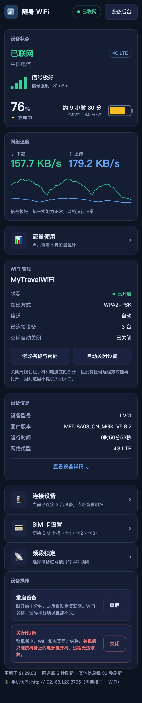
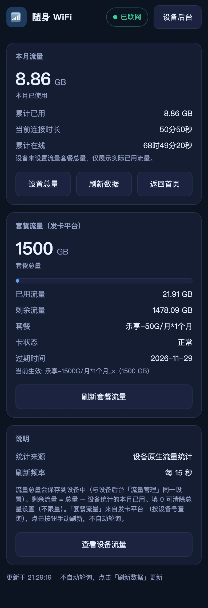
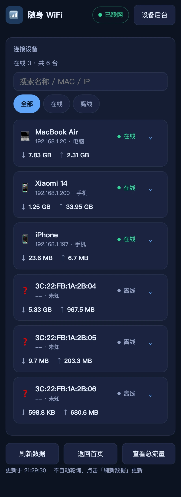
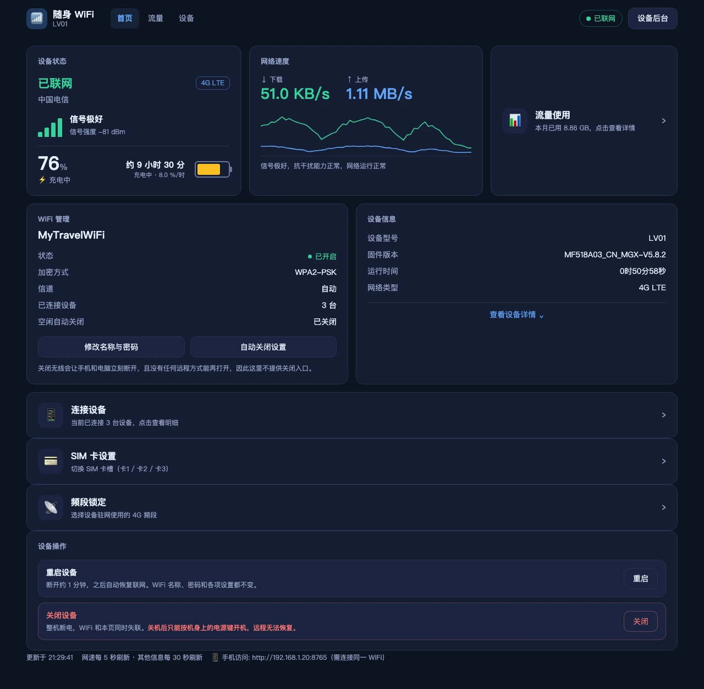

# 随身 WiFi 仪表盘

一个本地网页面板 + Android App，实时查看随身 WiFi（LV01 / MF518A03 固件）的联网状态、
电量、信号、网速、流量、连接设备等信息，并支持修改 WiFi 名称与密码、空闲自动关闭、
SIM 卡槽切换、频段锁定、流量套餐总量设置，以及重启 / 关闭设备。

- **后端**: PHP 8.4+（兼容最新 8.5，CI 双版本验证）或 **Node.js**（`server.js`，零依赖，接口一致）
- **前端**: 零第三方依赖，深色主题，PC / 平板 / 手机自适应，多页面按需加载
- **APK**: WebView 壳 + 内置 JS 网关，手机**无需任何服务器**直连设备（见下）
- 要求扩展 (PHP): curl / SimpleXML / json / mbstring（见 composer.json）

## 界面预览

手机端与桌面端是同一套页面，按宽度自适应：

<p>
  
  
  
</p>



> 截图取自真实设备（LV01 / MF518A03_CN_MGX）。SSID、SN、IMEI、ICCID、MAC 与内网地址
> 已替换为演示值；首页网速曲线为补满窗口的示意波形（实际需连续运行约 5 分钟才能画满）。

## 配置

设备密码**不入库**，两种方式任选：

```bash
# 方式一: 环境变量
WIFI_HOST=http://192.168.1.1 WIFI_USER=admin WIFI_PASS=你的设备密码 \
  PHP_CLI_SERVER_WORKERS=4 php -S 0.0.0.0:8765 -t public server.php

# 方式二: 本地配置文件（复制模板后填写, config.local.php 已加入 .gitignore 不会被提交）
cp config.local.php.example config.local.php
PHP_CLI_SERVER_WORKERS=4 php -S 0.0.0.0:8765 -t public server.php
```

绑定 `0.0.0.0` 是为了让同一 WiFi 下的手机也能访问（见「手机访问」）；只在本机用可改回
`127.0.0.1`，那样手机连不上。

## Node.js 版网关

`server.js` 是 PHP 版的完整 Node 移植（接口/缓存/boot 注入一致，零依赖，需 Node 18+）：

```bash
WIFI_PASS=你的设备密码 PORT=8766 node server.js
# 或 config.local.json: {"user":"admin","pass":"...","mgx_card":"..."}
```

## Android App (APK)

`android/wifi-dashboard.apk`（约 0.8 MB，debug 签名，含 Kotlin 运行时）——手机**无需任何服务器**，
连接随身 WiFi 后直接使用：

1. 下载 APK 安装（需允许未知来源）
2. 首次打开点右上角 **⚙** 填设备密码（发卡平台设备号可选），保存在手机本地
3. 所有功能与网页版一致：状态/网速/流量/设备/WiFi 管理/SIM 切换/频段锁定/设备操作（重启、关机）

原理：页面与内置 JS 网关（`core.js` + `gateway.js`，与 server.js 共享同一套核心逻辑）
打包进 APK assets；`MainActivity.kt` 在全屏 WebView 之外再起一个本地 HTTP 代理
（`127.0.0.1:8787`），把 `/mgx/...` 转发到发卡平台、其余转发到 `192.168.1.1`。
代理存在的原因有两个：WebView 的 `fetch` 强制携带 `Accept-Encoding: gzip`（该固件见此头即
KICKOFF），以及浏览器既不让你读 `Set-Cookie` 也不让你发 `Cookie`（发卡平台的会话只能由代理保管）。
若个别固件拒绝本机代理，可在 ⚙ 里填「服务器地址」（电脑上网关地址）切换为局域网模式。

### 通知栏状态条

App 在通知栏**常驻一条**状态通知，不进 App 也能瞟到当前状态：

| 位置 | 内容 | 来源 |
|---|---|---|
| 标题 | 网络制式 + 已连接/未联网（如「4G LTE · 已连接」） | 首页 5s 状态轮询的同一次结果 |
| 正文 | ↓ 下行速率 ↑ 上行速率 | 同上 |
| 标题行右侧小字（subText） | 在线设备数 · 信号档位 · 电量与充放电 | 同上 |
| 时间 | 相对时间（系统按分钟粒度渲染） | 该次采样的时刻；降级期间冻结在最后一次成功，用它看数据停了多久 |

- **默认开启**，开关在右上角 **⚙ → 在通知栏显示状态**（存 `localStorage`，跨重启保持）。关掉后当前这条立即撤掉，之后轮询也不再推送；重新打开即恢复
- 低重要性、静音、不振动、不弹横幅（每 5s 刷新一次，任何提醒都会变成刷屏）；`ongoing` 所以用户滑不掉，点它回到 App（复用既有任务栈，不会新开实例）
- **取不到数据时那一条就地变成降级文案**（标题带 ⚠ 并染红，正文是页面已经给出的具体原因：设备不可达 / 密码错 / 会话被踢 / 登录锁定），不新增第二条告警；恢复后异常标记自动清除
- 只刷新**应用存活期间**的数据：从首页轮询经原生桥推送；Activity 销毁（含从最近任务里划掉 App）即撤条，不会留一条还在报旧数字的假状态。所以这条通知的含义是「应用最后一次看到的样子」，应用不在就等于没有
- 权限：清单声明 `POST_NOTIFICATIONS`，Android 13+ 起由 `MainActivity` 在启动时主动申请。targetSdk 仍是 28，但实测（vivo / Android 16）低 targetSdk **并不会**自动授予该权限，不申请就一条都发不出去（`numBlocked` 一路涨）；将来把 targetSdk 提到 33+ 时这段申请依然要保留，只是届时由系统强制

**为什么没有做真后台刷新**（后台自己轮询、App 不开也能更新）：设备同一时刻**只允许一个管理会话**，
任何新登录都会把既有会话踢掉（被踢的一方此后一直收到 `KICKOFF`），而 Digest 会话（realm/nonce/nc 计数）
存在页面侧。原生若自己后台轮询，只有两条路，都被砍掉并归入待办：

1. 后台承载一个离屏 WebView 让页面网关继续跑——等于把浏览器藏在服务里，进程/内存开销与生命周期都要自己管
2. 把整套网关下沉进 `LocalProxy`——需要在 Kotlin 重抄一遍摘要认证、XML 解析与字段换算，与 `core.js` 变成两份实现

两条都超出「瞟一眼状态」的收益，所以这轮选定形态是**常驻一条 + 前台刷新**，不做后台轮询。

重新构建 APK（免 Gradle，需 Android SDK build-tools + Kotlin 编译器 2.0.x）：

```bash
cd android && ./build-apk.sh           # 产物: android/wifi-dashboard.apk
./tools/proxy-test/run.sh              # 可选: 不接手机验证本地代理（跑真实 HTTP 请求）
```

Kotlin 编译器只要 2.0.x：2.1+ 的 `kotlin.Metadata` 版本高于 build-tools 35 内置 R8 的识别上限
（2.0.0），`d8` 会对 stdlib 每个类刷一条警告。安装方式（无需 sudo）：

```bash
curl -L -o /tmp/k.zip https://github.com/JetBrains/kotlin/releases/download/v2.0.21/kotlin-compiler-2.0.21.zip
mkdir -p ~/.local/share && unzip -q /tmp/k.zip -d ~/.local/share   # 得到 ~/.local/share/kotlinc
```

## 使用

电脑连接到随身 WiFi 的网络后启动（见上方「配置」），浏览器打开 <http://127.0.0.1:8765>。
macOS 可直接双击 `启动仪表盘.command`（需先创建 config.local.php）。

### 手机访问

无需在手机上安装任何东西——服务绑定在 `0.0.0.0`，手机连接**同一个随身 WiFi** 后，
浏览器打开 `http://<电脑的局域网IP>:8765` 即可（启动窗口和首页页脚都会显示这个地址）。
页面本身就是手机自适应布局（320px 起单列、底部弹窗、44px 触控按钮）。

注意：

- 电脑必须保持开机运行服务（合盖休眠会断）
- 首次从局域网访问时，macOS 可能弹窗询问是否允许 php 接受入站连接，点「允许」即可
- 仪表盘本身没有登录保护，同一 WiFi 下的设备都能访问；个人自用场景可接受，介意的话不要在公共 WiFi 环境（咖啡馆等）以局域网模式运行

## 页面结构（按需加载，互不拖慢）

| 页面 | 数据接口 | 刷新 | 说明 |
|---|---|---|---|
| `/` 首页 | `/api/status`（status1） | 网速区块 5s · 其他区块 30s | 设备状态、信号、电量、实时速率曲线、WiFi 管理（名称与密码合并修改/空闲自动关闭）、SIM 卡槽切换、频段锁定、设备信息、设备操作（重启/关机） |
| `/traffic` 流量 | `/api/traffic`（statistics） | 手动（进入时加载一次） | 本月/累计流量、**套餐总量与剩余**（进度条、剩余、占比、超出提示）、连接时长；**套餐流量卡**（发卡平台总流量/已用/剩余，手动刷新）；入口在首页流量卡片 |
| `/devices` 设备 | `/api/devices`（device_management） | 手动（进入时加载一次） | 连接设备表格/卡片、搜索筛选、单设备流量明细；入口在首页设备卡片 |

首页只拉 status1（最快路径）；流量与设备数据收进二级页面，卡片上的数字来自缓存、
不会触发额外设备请求。SIM 卡设置与频段锁定均为按需加载：

- **SIM 卡槽切换**：点击入口时才查询当前卡槽（卡1 / 卡2 / 卡3，与原厂 eSIM 页一致），
  下发 `RGW/esim/simmode`；设备若开启密码校验会要求输入切换密码（cmd_status=pw 时提示密码错误）
- **频段锁定**：点击入口时才读取频段配置（与原厂「频段」页一致，位掩码
  ltebandl/ltebandh/ltebandext 对应 FDD B1-32 / TDD B33-64 / FDD B65+，仅显示硬件支持的
  频段），勾选后下发 `RGW/customconfig`，支持全选，当前驻留频段实时显示（如 FDD B8）

## 首屏性能

| 场景 | 耗时 |
|---|---|
| 首页刷新（服务运行中） | **约 90ms**（HTML 注入缓存数据，先渲染再后台刷新） |
| 冷启动（首次/重启后） | 约 3s（登录 + status1 单接口，设备本身较慢） |
| 网速轮询 | 每 5s 一次 status1（约 0.9s，其余区块 30s 才随轮询更新一次） |
| 静态资源响应 | 约 2ms（4 worker，不会被数据请求阻塞） |

优化手段：
1. **页面注入首屏数据**：输出 HTML 时命中缓存就把 JSON 注入 `window.__BOOT__`，前端先渲染缓存再拉新数据（纯读缓存，不阻塞）
2. **接口分级缓存**：status1（4s）/ statistics（20s）/ device_management（20s）各自 TTL，多标签页、多 worker 共享（`.data_cache.json` + 文件锁）
3. **并行拉取**：`/api/summary` 兼容接口用 curl_multi 并行取三源（实测 1.2s vs 串行 5.7s）
4. **会话持久化**：Digest 会话存 `.mifi_session.json`，多 worker 共享 nc 计数、跨重启复用，失效自动重登
5. **多 worker**：`PHP_CLI_SERVER_WORKERS=4`，静态页/操作与慢速数据请求互不阻塞

## 接口

- `GET /api/status` — 首页主数据（状态/信号/电池/速率/WiFi/运行信息）
- `GET /api/traffic` — 流量统计（本月/累计、套餐总量与剩余、连接时长）
- `GET /api/devices` — 连接设备列表
- `GET /api/summary` — 全量数据（兼容保留）
- `GET|POST /api/sim` — SIM 卡槽状态 / 切换（`{slot: 0|1|2, pw?}`），复用设备原厂 esim 接口
- `GET|POST /api/band` — 频段配置 / 锁定（`{bands: [1,3,8,...]}`），复用设备原厂 customconfig 接口
- `POST /api/traffic/quota` — 套餐总量设置（`{quotaGb: 150}`，0=清除），
  写入设备原生 `total_available_month` 字段（与设备后台「流量管理」同一设置），剩余 = 总量 − 设备统计已用
- `GET /api/remote-traffic` — 发卡平台套餐流量查询（`?refresh=1` 强制刷新，默认 120s 缓存），
  需在 config.local.php 配置 `mgx_card`；进入流量页加载一次，手动刷新，不轮询
- `GET /api/wifi` — 无线基础配置：目前只取「空闲自动关闭」（`wifi_sleep_time`，`0`=关闭，`10~60`=分钟）
- `POST /api/wifi` — `{action: security|autooff, ...}` WiFi 设置，复用设备原厂 set 接口。
  `security` 一次请求同时写名称与密码（可只改其一，不改密码时服务端回填设备原密码，
  保证 `uapxb_wlan_security_settings` 档案完整、无线只重启一次）。
  另有 `{action: 'toggle', enable: '0'|'1'}` 可写 `wlan_enable`，但**必须显式给字符串 `'0'`/`'1'`**，
  缺失或其它值一律拒绝（不做「取反」也不给默认值）—— 关掉无线后没有任何远程回滚手段。
  首页已不提供这个入口，保留接口仅供明确知道后果的脚本调用。
- `POST /api/router` — `{action: reboot|poweroff, confirm?}` 整机重启 / 关机。
  与上面所有 set 命令不同，这两个动作**不写任何配置字段**：原厂固件是靠 `method=get` 取一个
  action 文件来触发的（`file=reset` / `file=power_off`，见设备端 `js/panel/router/*_router.js`），
  取到这个文件即执行。因此响应里没有 `<RGW>`、也没有可回填的结果，只能按「认证是否通过」判断
  成败；设备执行时先断开连接属于预期现象，不作失败处理。
  `poweroff` 必须显式带 `confirm: true`（服务端硬拦），因为关机后只能按机身电源键开机。

所有 set 命令均带 `<?xml version="1.0" encoding="US-ASCII"?>` 声明头（与原厂
getXMLDocToString 一致，缺它设备会报 `CGI parse error`），并把设备错误响应
（Error/UNAUTHORIZED）作为失败抛出，不会假成功。

## 检查与测试

```bash
node --test tests/core.test.js     # 9 项: Digest 固定向量 / 设备列表解析 / 空闲自动关闭
                                   #      / 整机动作 / toggle 严格性 / 名称密码合并写入
php tests/digest_vectors.php       # 同一组向量的 PHP 侧（需 PHP 8.4+）
```

测试用的是**假凭据**（`admin` / `testpass`）与假 SSID，不要改成真实设备口令 —— 本仓库是公开的。

CI（`.github/workflows/ci.yml`）在 PHP 8.4 / 8.5 上运行上述两项与页面烟雾测试，
并用 `node --check` 检查 `server.js` 和 `public/*.js`。触发条件是 **push 到 `main` 或开 PR**——
在功能分支上直接 push 不会跑，提 PR 时才会验证。
本机没有 PHP 时可用容器跑同款检查：

```bash
docker run --rm -v "$PWD":/app php:8.4 php -l /app/server.php
docker run --rm -v "$PWD":/app php:8.4 php /app/tests/digest_vectors.php
```

## 文件

- `server.php` / `server.js` — 网关服务（PHP / Node 双实现，登录 / 缓存 / 并行拉取 / 接口与页面路由）
- `public/core.js` — 共享核心：MD5（原厂同源实现）、Digest、XML 解析、数据组装
- `public/gateway.js` — APK 内置浏览器网关（经本地代理转设备与发卡平台）
- `public/index.html`、`public/traffic.html`、`public/devices.html` — 三个页面
- `public/app.css`、`public/app.js` — 公共样式与脚本（含 API 适配层）
- `android/kotlin/com/sunzehui/wifimanage/MainActivity.kt` — APK 壳：全屏 WebView + 本地代理 `LocalProxy`
- `android/kotlin/com/sunzehui/wifimanage/StatusNotifier.kt` — 通知栏常驻状态条 + 页面→原生的窄桥 `StatusBridge`
- `android/res/drawable/ic_stat_mifi.xml` — 状态栏小图标（24dp 纯白 alpha 矢量 WiFi）
- `android/tools/make_icon.py` — 程序化生成启动图标（`res/mipmap-*/`、`public/icon.png`）
- `android/tools/proxy-test/` — 不接手机验证代理的 JVM 冒烟测试（`run.sh`）
- `tests/` — Node / PHP 单元测试（Digest 固定向量、设备列表解析、各 set/action 的 XML 构造）
- `docs/ui-redesign-requirements.md` — 2026-10-25 的 UI 改版需求稿（归档）
- `启动仪表盘.command` — macOS 双击启动
- `.mifi_session.json`、`.data_cache.json` — 运行时自动生成的会话与缓存文件

## 工作原理

1. 登录：`GET /login.cgi` 取 Digest 质询（realm/nonce），按原厂前端算法计算 response
   后访问 `login.cgi?Action=Digest&...` 完成一键登录；该请求还必须同时带一个
   `uri="/cgi/xml_action.cgi"` 的 `Authorization` 头（原厂 `authentication()` 的做法），
   设备靠它登记管理会话 —— 只发查询串会一直返回 `<login_status>UNAUTHORIZED</login_status>`。
   会话过期自动重新握手。
2. 读数据：带 `Authorization: Digest`（uri 为 `/cgi/xml_action.cgi`，nc 递增）请求
   `xml_action.cgi?method=get&module=duster&file=status1|statistics|device_management`。
3. 写设置：`method=set` 通道下发 `uapxb_wlan_security_settings`（SSID 十六进制 UTF-16 编码 /
   按当前加密模式节点写 key）和 `uapxb_wlan_basic_settings`（`wlan_enable` 开关、
   `wifi_sleep_time` + `wifi_sleep_action=1` 空闲自动关闭，后者两个字段必须一起发才生效）。
   其中 `wlan_enable` 只保留接口、页面不给入口（原因见「说明」）。
4. 字段换算与原厂后台一致：LTE 时 RSRP=-140+raw dBm、RSRQ=-19.5+raw/2 dB、
   RSSI=-110+raw dBm；电量百分比取 `Battery_voltage`；SSID 为 UTF-16 十六进制编码。

### 设备流量的字段来源（核对数值真伪用）

| 原厂页面 | 数据文件 | 用到的字段 |
|---|---|---|
| `js/panel/home_network/data_traffic.js`（设备流量） | `device_management` | `rx_data_used` / `tx_data_used`（累计）、`*_monthly`、`*_last3day`，按 1024 进制显示 GB/MB/KB |
| `js/panel/home_network/connected_device.js`（已连接设备） | `device_management` | 名称/IP/MAC/类型/时长，不含流量 |
| `js/panel/internet/traffic_statistics.js`（流量统计） | `statistics` | 整机 `WanStatistics.total_used_month` 等 |

`/api/devices` 原样透传 `client_list` 的计数（`public/core.js` 的 `buildDevices`），
不做单位换算或二次计算。本机固件（MF518A03_CN_MGX-V5.8.2）实测出现过个别客户端
计数基数异常（达 PB 级，与整机 `total_used_month` 相差数个数量级）——判断真实用量以
`statistics` 为准。

## 说明

- 设备后台本身：<http://192.168.1.1/> （页面右上角有直达链接）
- 若页面提示"设备不可达"，说明电脑当前不在随身 WiFi 的网络里。
- 修改 WiFi 名称或密码会使设备无线网络短暂重启（同一次保存只重启一次），所有连接设备需要重连，页面弹窗中已提示。
- 「空闲自动关闭」是设备自带功能（原厂无线设置页的 `wifi_sleep_time`）：开着时设备空闲 N 分钟会
  自己关掉无线，**之后就再也连不回来**（AP 消失，页面 / APK / 所有远程入口同时失效；恢复方式取决于
  机型，固件自带帮助页里没有说明，不要指望软件自救）。首页可以查看和修改，建议保持「不自动关闭」。
- 因此首页**不提供「关闭 WiFi」按钮**：关掉无线 = 本页面、APK、所有远程入口同时失联，且没有任何
  软件手段能把它重新打开（写 `wlan_enable=1` 的请求也得走这条已经没有的链路）。卡里只显示状态，
  下方有一行说明。要省电请用「空闲自动关闭」——它同样会让远程入口失效，只是由设备按空闲时间控制，
  而不是一键把自己关在门外。
- 「设备操作」里的两项按原厂固件的方式触发（`file=reset` / `file=power_off`，method=get）：
  - **重启**会断开约 1 分钟，页面进入「设备正在重启」状态，恢复后自动收起。由于设备对不认识的文件
    也返回 200 空响应，页面用「它是否真的掉线过」来确认指令生效，没观察到就如实提示可能不支持。
  - **关机**是不可远程撤销的操作（整机断电，只能按机身电源键开机），所以是红色弹层 + 勾选确认，
    且服务端要求 `confirm: true`；关机后页面停在「设备已关机」，点「我已开机」才恢复正常轮询。
